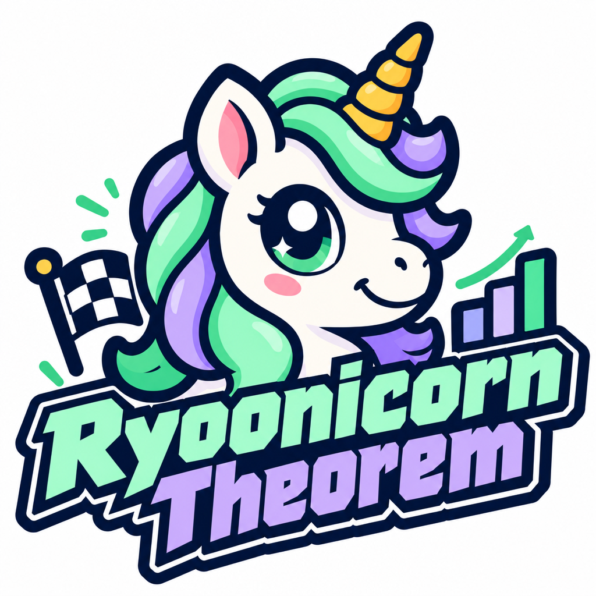

<p align="center">
  
</p>

# Ryoonicorn Theorem — trifecta value-combination calculator

[한국어](README.ko.md) · [Paper (English)](paper/ryoonicorn-theorem-paper.md) · [논문 (한국어)](paper/ko/한국_경마_배당_시장의_정보_효율성_7개_승식_풀_검증.md)

**The Ryoonicorn Theorem** — an empirical proposition about pari-mutuel markets:

> When several pools are written on the same event, prices in a thin pool fail to reflect information already contained in the thick pools.
> Reconstructing the thin pool's prices from the thick pools' implied probabilities therefore reveals mispricing larger than the takeout.

It is a regularity verified on data, not a mathematically proven theorem. The edge comes from how money is distributed across pools, not from knowledge of the horses, so whether it holds in other markets with the same structure (Korean keirin and boat racing, exotic pools abroad such as Japan's 3連単 or Hong Kong's Triple Trio, combination pari-mutuel sports pools) needs separate testing.

## Verified in Korean horse racing

Seoul and Busan-Gyeongnam, 2019–2026, 12,824 races, final odds for every combination in all seven pools (public KRA data).

- **Thick pools:** trio (any order, ~154 combinations per race, KRW 0.7–1.1 billion) and exacta.
- **Thin pool:** trifecta (exact order, ~925 combinations per race, median turnover ~KRW 530 million; about 20% of combinations sit at the 9999.9 odds cap).
- A conditional logit over combinations, fed only trio and exacta implied probabilities, is **+0.019 to +0.027 log-likelihood per race more accurate** than the trifecta pool's own prices. The trifecta pool's own weight in the combined model is just 0.10.
- Fundamental handicapping (78 features: form, jockey, trainer, distance, weight, ratings…) adds nothing once the trio and exacta pools are in. Neither do Korea-only training records (swimming, daily workouts, routine regularity) — all failed pre-registered tests.
- Value betting on final odds, EV = P(combination) × trifecta odds > 1.4, two-pool model, 12-runner races: **+43% after the 27.3% takeout**, about 35 bets per race, one hit every 41 races, very wide CI (−56% to +180%).
- Market impact: with pool turnover data, the edge survives stakes up to about **KRW 56,000 per combination** (breakeven).
- The value is spread thinly over 35–47 low-popularity combinations per race. It cannot be shortlisted by probability, and it cannot be found from the top-40 odds board the track displays: you need every trifecta combination's odds.

Weights were fitted on 2024 races and frozen (`data/weights.json`); evaluation is on 2025-01 to 2026-09; prospective validation with pre-close odds runs from 2026-10. The pre-registration document is `data/PREREG_exotic.md`. Full details: [the paper](paper/ryoonicorn-theorem-paper.md).

## What the app does

Seven minutes before the close, upload **three photos** of the odds screens (trio, exacta, trifecta). The app reads them, checks the numbers, and returns **every** trifecta combination whose combined probability × odds exceeds the threshold — typically 35–47 in a 12-runner race. No human picking.

## Run

```bash
pip install -r requirements.txt
export ANTHROPIC_API_KEY=...        # only for reading photos (Claude vision); not needed for pasted text
streamlit run app/streamlit_app.py
```

## How to use

1. Seven minutes before the close, photograph the **full-combination** odds screens for trio, exacta and trifecta (several photos per pool if it spans pages).
2. Enter racecourse, race number and field size, upload the photos → **Compute combinations**.
3. Sanity check: for each pool, Σ(1/odds) should be within ±3% of 1/(1 − takeout). If not, compare the flagged combinations with the screen.
4. Bet the whole list (EV > threshold). If there are fewer than 20 combinations, skip the race.
5. After the race, add final odds and the result to the matching record in `data/log.jsonl` for the forward-validation tally.

No photos? Paste odds as text, one per line: `1-2-3 1234.5`.

## Fixed rule

| Item | Value |
|---|---|
| Model | Ryoonicorn Theorem (`trio_exa`: trio + exacta combination), 2024 weights frozen |
| Threshold | EV > 1.4 (adjustable 1.2–1.6 in the app, default 1.4) |
| Bets | **every** combination above the threshold, KRW 1,000–10,000 each |
| Skip | fewer than 20 value combinations |
| Record | pre-close odds, final odds, hit or miss |

## Formulas

Implied probability of combination c in pool f: π_f(c) = (1/O_c) / Σ(1/O). Lower-dimensional pools (exacta, win) are broadcast onto ordered combinations c = (i, j, k); the win pool is converted to 1-2-3 probabilities with Harville–Benter (λ₂ = 0.773, λ₃ = 0.652).

P(c) ∝ exp( Σ_f β_f · ln π_f(c) ),  EV(c) = P(c) × O_tri(c)

Market impact: existing money on c, A_c = S(1−t)/O_c; odds after your stake B, O'_c = (S+B)(1−t)/(A_c+B).

## Repository layout

```
app/model.py          combined probability, EV, value combinations, sanity check (pure numpy, tested)
app/ocr.py            photo → odds (Claude vision) / text parser
app/streamlit_app.py  UI
data/weights.json     frozen weights, λ, takeout
data/PREREG_exotic.md pre-registration (English; original Korean in PREREG_exotic.ko.md)
paper/                paper (English); paper/ko/ original Korean
tests/                pytest
```

```bash
python -m pytest -q
```

## Using it outside Korea

`app/model.py` is market-agnostic: give `RaceOdds` a trio dict `{(a,b,c): odds}` with a<b<c, an exacta dict `{(i,j): odds}` and a trifecta dict `{(i,j,k): odds}`, then call `compute()` and `value_combos()`. The frozen weights were fitted on Korean pools, so for another market refit them on that market's historical final odds before trusting the EVs.

## Caveats

- KRA does not publish live odds through its API. This tool only reads **photos the user takes**.
- It is not connected to ticket purchasing. It is a record-keeping and validation tool; betting outcomes are the user's responsibility.
- Keep API keys in environment variables only. Do not commit `data/log.jsonl` or `.env`.
